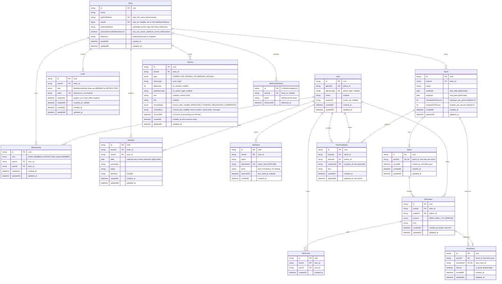

# Architecture & Database Schema

SprintProof is an async Scrum log and contribution tracker for student software teams.

## Layering Architecture

The application enforces one-way layering: `app/` → `server/` → `lib/`.

- **`src/app/`**: Next.js App Router pages, layouts, and route handlers. Validates input with Zod, checks authorization, and invokes `server/` repositories.
- **`src/server/`**: Side effects, database interactions via Prisma Client (`src/server/db.ts`), GitHub client wrappers, and Pusher realtime triggers.
- **`src/lib/`**: Pure business logic with no I/O, no database imports, and deterministic inputs/outputs.
- **`src/types/`**: Shared TypeScript definitions.

## Database Schema (Prisma 7)

PostgreSQL database models managed via Prisma schema (`prisma/schema.prisma`). All models use PascalCase singular naming and map to snake_case plural tables using `@@map`. Every foreign key uses `onDelete: Cascade`.

### Entity-Relationship Diagram

### Table Mappings & Key Constraints

| Table | Model | Unique constraints | Indexes |
| --- | --- | --- | --- |
| `users` | `User` | `github_id`, `github_login` | — |
| `teams` | `Team` | `repo_full_name`, `repo_id` | — |
| `memberships` | `Membership` | `[user_id, team_id]` | `user_id`, `team_id` |
| `invites` | `Invite` | `token` | `team_id` |
| `sprints` | `Sprint` | — | `team_id` |
| `standups` | `Standup` | `[team_id, user_id, date]` | `[team_id, date]`, `user_id` |
| `activities` | `Activity` | `[team_id, type, sha]`, `[team_id, commit_key]` | `team_id`, `actor_login` |
| `webhook_deliveries` | `WebhookDelivery` | `id` (primary key) | `team_id` |
| `api_tokens` | `ApiToken` | `token_hash` | `user_id` |
| `retros` | `Retro` | `sprint_id` | — |
| `retro_items` | `RetroItem` | — | `retro_id`, `author_id` |
| `retro_votes` | `RetroVote` | `[item_id, user_id]` | `user_id` |
| `action_items` | `ActionItem` | `retro_item_id` | `sprint_id` |
| `peer_feedback` | `PeerFeedback` | `[sprint_id, author_id, recipient_id]` | `author_id`, `recipient_id` |

- **`users` (`User`)**: `github_id` is required and unique. `github_login` is unique but nullable: after a GitHub rename the login can move to another account, and the previous holder's login is cleared until they sign in again (#6). No email column (`docs/decisions/001-github-oauth-scopes.md`).
- **`teams` (`Team`)**: Holds the connected GitHub repo (`repo_full_name`, GitHub's `owner/name`, unique so a webhook delivery maps to one team), GitHub's numeric repository ID (`repo_id`, nullable and unique, set on the first webhook delivery, #11), the secret that signs the team's webhook deliveries (`webhook_secret`, random, shown only to the lead, #115) with `can_use_server_webhook_secret` (true only for teams from before #115 that may still sign with the server-wide secret, decision 005) and the team timezone (`timezone`, default `America/Los_Angeles`).
- **`memberships` (`Membership`)**: Join model between `User` and `Team` with `role` (`LEAD`, `MEMBER`, `INSTRUCTOR`; default `MEMBER`). Compound unique constraint on `[user_id, team_id]`.
- **`invites` (`Invite`)**: Invite links. `role` is `MEMBER` or `INSTRUCTOR`; a link works until `expires_at` (7 days after creation) unless `revoked_at` is set. At most one active link per team and role: creating a new one revokes the previous one. `token` is stored as is rather than hashed so whoever manages the link can copy it again from Settings (#7): the lead for member links, course staff and the team's instructors for instructor links (#116).
- **`sprints` (`Sprint`)**: Calendar boundaries stored as `@db.Date` (`start_date`, `end_date`), along with `standups_per_person` (default 3) and `reviews_per_person` (default 5).
- **`standups` (`Standup`)**: Belongs to a team and a calendar day (`date`, `@db.Date`, in the team timezone), not to a stored sprint. It's listed under the sprint whose dates contain its day, so it follows its day when sprint dates change (#56, `docs/decisions/003-standups-belong-to-days.md`). `@@unique([team_id, user_id, date])` keeps at most one standup per person per day.
- **`activities` (`Activity`)**: Activity records with `occurred_at` for event time and `@@unique([team_id, type, sha])` deduplicating commit SHAs. `review_state` holds GitHub's `review.state` for a `REVIEW` row, so the activity feed can say "approved", "requested changes on" or "commented on" #N (#57). It's null for every other type, for reviews stored before #57, and for a review whose state GitHub doesn't document. Those reviews show as "reviewed #N". Every state counts the same under R3. `commit_key` is a SHA-256 of a `COMMIT` row's author name, email, author date and full message, unique per team, so the copy a rebase or an amend makes under a new SHA is stored once (#114, `docs/decisions/004-count-each-commit-once.md`). It's null for other types, for commits stored before #114 until `scripts/backfill-commit-keys.mjs` fills it, and when a payload leaves out the author's name, email or date; those commits are deduplicated by SHA only. GitHub's own commits on the default branch aren't stored at all.
- **`webhook_deliveries` (`WebhookDelivery`)**: One row per GitHub delivery, keyed by the `X-GitHub-Delivery` id so a redelivered event is stored once (#11). `team_id` is nullable because a delivery can arrive for a repo that no team has connected.
- **`api_tokens` (`ApiToken`)**: Personal tokens for the public API (#16). Only the SHA-256 hash (`token_hash`, unique) is stored; the token itself is shown once. `last4` lets Settings tell tokens apart, and `last_used_at` is updated when a token is used. Revoking deletes the row.
- **`retros` (`Retro`)**: One per sprint (`sprint_id` is unique), opened by the lead (#13). `closed_at` is null while it's open; closing sets it and makes the action items, after which its items and votes don't change. Writes take the `SPRINT_RETRO_LOCK` advisory lock for the sprint, so a member's concurrent votes can't pass 3 and no vote lands after closing has counted them.
- **`retro_items` (`RetroItem`)**: An item in "Went well" or "To improve" (`column`), with its author. `created_at` breaks vote ties (rule R6).
- **`retro_votes` (`RetroVote`)**: One member's vote on one item; `@@unique([item_id, user_id])` keeps it to 1 per item. The 3 per retro are checked when voting.
- **`action_items` (`ActionItem`)**: A "To improve" item carried into the sprint that starts next (`sprint_id`) when its retro closed; `retro_item_id` is unique, so an item is carried once. Its text and votes stay on the retro item. `is_done` is the done checkbox on the next sprint's retro.
- **`peer_feedback` (`PeerFeedback`)**: One author's partner feedback about one teammate (`recipient_id`) for a sprint (#14); `@@unique([sprint_id, author_id, recipient_id])` keeps it to one entry, which saving again replaces. Written only while the sprint's retro is open, under the same `SPRINT_RETRO_LOCK`, so nothing changes after closing. Only the team's instructors read it (rule R7); the author reads back only their own entries. "Feedback" is uncountable, so the table name isn't pluralized.

### Enums

| Enum | Values | Used by |
| --- | --- | --- |
| `MembershipRole` | `LEAD`, `MEMBER`, `INSTRUCTOR` | `Membership.role`, `Invite.role` |
| `ActivityType` | `COMMIT`, `PR_OPENED`, `PR_MERGED`, `REVIEW` | `Activity.type` |
| `ReviewState` | `APPROVED`, `CHANGES_REQUESTED`, `COMMENTED` | `Activity.reviewState` |
| `RetroColumn` | `WENT_WELL`, `TO_IMPROVE` | `RetroItem.column` |

### Migrations

In `prisma/migrations/`, applied in order:

| Migration | Issue | Change |
| --- | --- | --- |
| `20261104214220_init` | #5 | Enums and the `users`, `teams`, `memberships`, `sprints`, `standups` and `activities` tables; standups keyed by `[sprint_id, user_id, date]` |
| `20261104232008_drop_user_email_require_github_id` | #6 | Drops `users.email`; `github_id` becomes required |
| `20261105224716_add_team_repo_and_invites` | #7 | `teams.repo_full_name` (unique) and the `invites` table |
| `20261106000000_add_repo_id_and_webhook_deliveries` | #11 | `teams.repo_id` (unique, nullable) and the `webhook_deliveries` table |
| `20261108081720_add_api_tokens` | #16 | The `api_tokens` table |
| `20261109224149_standups_belong_to_team` | #56 | Fills `standups.team_id` from each standup's sprint, drops `sprint_id`, and replaces the unique key with `[team_id, user_id, date]`. Fails if a person already has two standups on one day in a team |
| `20261112025033_add_activity_review_state` | #57 | The `ReviewState` enum and `activities.review_state` (nullable, no default, so existing rows stay null) |
| `20261112050000_add_retros` | #13 | The `RetroColumn` enum and the `retros`, `retro_items`, `retro_votes` and `action_items` tables (new tables only) |
| `20261112074050_add_activity_commit_key` | #114 | `activities.commit_key` (nullable, so existing rows stay null until `scripts/backfill-commit-keys.mjs` fills them) and the unique index on `[team_id, commit_key]` |
| `20261112090000_add_team_webhook_secret` | #115 | `teams.webhook_secret`, filled for existing teams from `gen_random_uuid()` and then required, and `teams.can_use_server_webhook_secret` (true for existing teams, default false) |
| `20261112080628_add_peer_feedback` | #14 | The `peer_feedback` table (new table only) |
