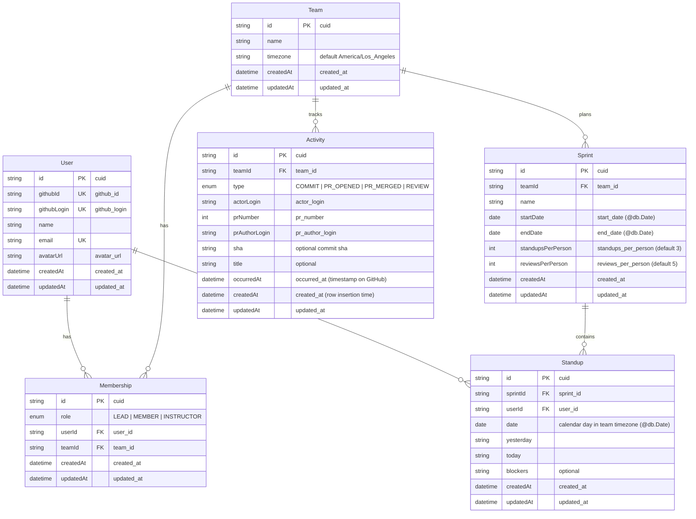

# Architecture & Database Schema

SprintProof is an async Scrum log and contribution tracker for student software teams.

## Layering Architecture

The application enforces one-way layering: `app/` → `server/` → `lib/`.

- **`src/app/`**: Next.js App Router pages, layouts, and route handlers. Validates input with Zod, checks authorization, and invokes `server/` repositories.
- **`src/server/`**: Side effects, database interactions via Prisma Client (`src/server/db.ts`), GitHub client wrappers, and Pusher realtime triggers.
- **`src/lib/`**: Pure business logic with no I/O, no database imports, and deterministic inputs/outputs.
- **`src/types/`**: Shared TypeScript definitions.

## Database Schema (Prisma 7)

PostgreSQL database models managed via Prisma schema (`prisma/schema.prisma`). All models use PascalCase singular naming and map to snake_case plural tables using `@@map`.

### Entity-Relationship Diagram

### Table Mappings & Key Constraints

- **`users` (`User`)**: Unique constraints on `github_id`, `github_login`, and `email`.
- **`teams` (`Team`)**: Holds the team timezone (`timezone`, default `America/Los_Angeles`).
- **`memberships` (`Membership`)**: Join model between `User` and `Team` with `role` (`LEAD`, `MEMBER`, `INSTRUCTOR`). Compound unique constraint on `[user_id, team_id]`.
- **`sprints` (`Sprint`)**: Calendar boundaries stored as `@db.Date` (`start_date`, `end_date`), along with `standups_per_person` and `reviews_per_person`.
- **`standups` (`Standup`)**: Calendar day stored as `@db.Date` (`date`) in team timezone with compound unique constraint `@@unique([sprint_id, user_id, date])` ensuring at most one standup per person per day.
- **`activities` (`Activity`)**: Activity records with `occurred_at` for event time and `@@unique([team_id, type, sha])` deduplicating commit SHAs.
